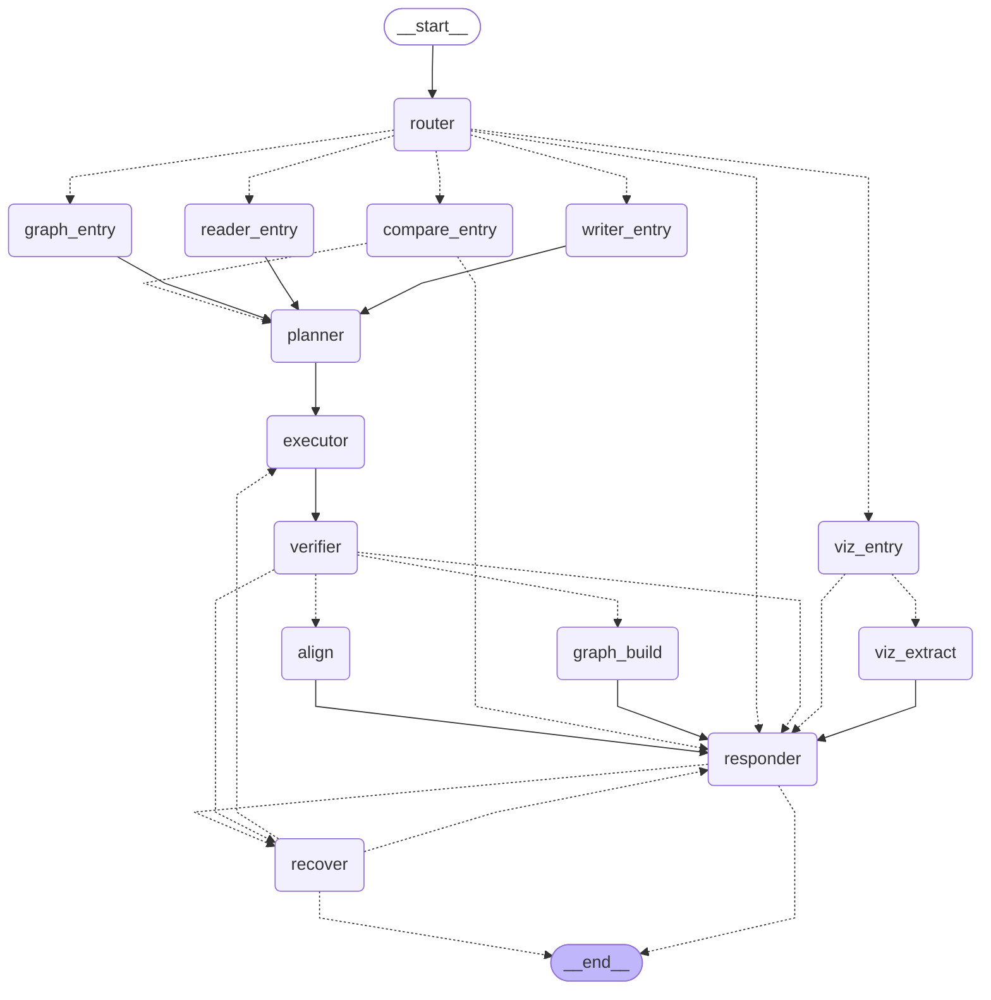
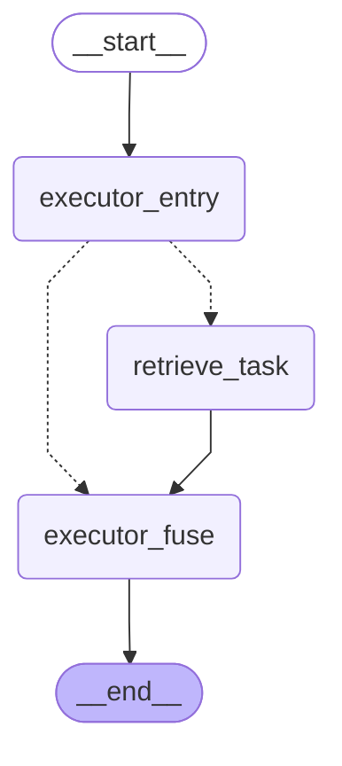

# Meridian Agent 状态图（代码自动生成）

> 本图由 `build_graph().get_graph().draw_mermaid()` 自动生成——架构图即代码，节点/边改动后重跑该命令即可同步：
>
> ```bash
> cd api && uv run python -c "from app.agents.graph import build_graph; print(build_graph().get_graph().draw_mermaid())"
> ```
>
> 评审叙事：工作流编排（LangGraph 显式状态机）+ 节点即卡片执行可视化。
> 当前版本（2026-11-09 重新生成）：主图 14 节点——含 5 个 Agent 专属入口（reader/compare/graph/writer/viz）与 3 个专属产物节点（align/graph_build/viz_extract）；Executor 为独立编译子图（executor_entry → Send 扇出 retrieve_task×N → executor_fuse），经 wrapper 节点手动 invoke（父图 trace 不经子图 reducer 回流）。

## 主图（Router → 5 Agent 入口 → Planner → Executor → Verifier → 产物节点 → Responder）



条件边语义（`agents/graph.py`）：

- `router → *`：chitchat 直达 responder；其余按 INTENT_AGENT 路由表选 Agent 入口（UI 可 `forced_agent` 强制指定）；
- `compare_entry / viz_entry`：入口 Guardrail——compare 单篇拒绝 → responder；viz 无表拒绝 → responder；viz 正常 → 专用管线 `viz_extract`（不查 chunk，只走 DocIR 表格）；
- `verifier → *`：证据充分 → `align`（compare）/`graph_build`（graph）/`responder`；证据不足且恢复预算未尽 → `recover`；预算尽 → compare/graph 仍过产物节点出部分产物（缺额如实呈现）；
- `recover → *`：策略①改写检索面重检索（→ executor，≤2 次）/ 策略③注入纠错反馈定向重生成（→ responder，格式违规 ≤2 次）/ 预算尽 → END；全局 `MAX_RECOVER=3`；
- `responder → recover`：收尾发现 `pending_failure`（如格式无效）且预算未尽 → 回 recover 定向重生成。

## 子图（Executor：Send 并行扇出）



- `executor_entry` 按（检索面 × 论文）经 LangGraph `Send` 扇出 N 路 `retrieve_task`（每路独立跑 `rag.indexing.hybrid_search`），`executor_fuse` 做 RRF(k=60) 跨分支融合 + compare 每（维度,论文）组保底 + bge-reranker 全局精排（未配 key 降级融合排序并记 guardrail）；
- 子图经 `executor_node` wrapper 手动 invoke：只回传 evidence/branch_stats/trace/failures/guardrails；configurable 白名单只透传 queue（防父图 checkpointer 泄入无 thread_id 的子图）。

## 节点清单（`build_graph()` 实测，2026-11-09）

14 个功能节点（另有 `__start__`/`__end__` 连接子）：

| 节点 | 职责 |
|---|---|
| router | 意图识别 + Agent 分发（LLM 分类/规则兜底/UI 强制） |
| planner | 检索面规划（LLM 改写英文子查询/规则；扇出护栏 ≤12） |
| reader_entry / compare_entry / graph_entry / writer_entry / viz_entry | 五专属入口 Guardrail（范围锁定/单篇拒绝/无表拒绝） |
| executor | retrieve_task 并行检索（子图 Send 扇出，≤12 路）→ RRF 融合 → rerank |
| align | Compare 维度对齐表（格级 E#、行级冲突启发） |
| viz_extract / graph_build | Viz 表格提取→chart_spec / Graph 引用构图+指标 |
| verifier | Claim-Citation 校验（L1-L4；缺失面/论文覆盖不足 → recover） |
| recover | 三策略恢复（①重检索 ②降级 ③定向重生成；全局预算 ≤3） |
| responder | 流式生成 + [E#] 后验 + ClaimTrace（support 级块锚点精化） |

## 断点续跑

- `agents/checkpointer.py` 提供 SqliteSaver（`data/checkpoints.db`），thread_id = `"{conversation_id}#{turn}"`（每轮独立，防累加键跨轮污染）；
- 图级异常时线程标记 failed，`resume_stream()` 以 `invoke(None)` 从最近 checkpoint 续跑——已完成节点不重跑，累加键（trace/raw_hits 等）从 checkpoint 恢复不重复；
- 启动时 `recovery.start_recovery_worker()` 自动派发上次崩溃/失败遗留的未完成线程续跑（`MAX_RESUME_ATTEMPTS=3` 防死循环）；
- 事件流经 `_TeeQueue` 记账落盘 `trace_events`（thread_id 即 trace_id），`GET /api/qa/{trace_id}` 完整回放（首次+续跑合并历史）。
