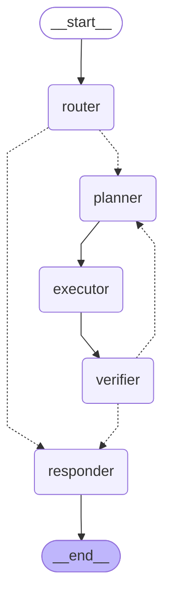
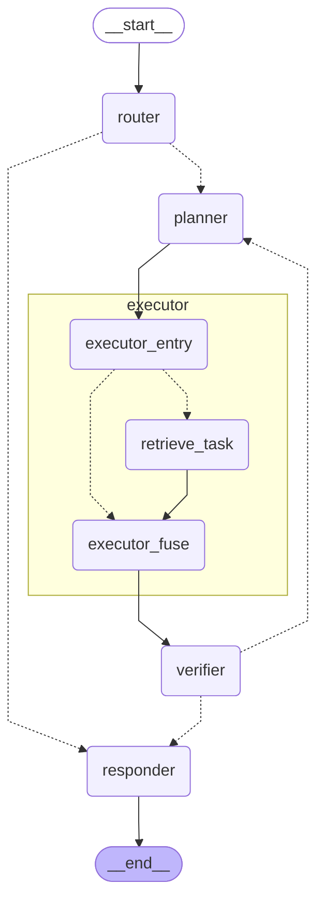

# Meridian Agent 状态图（代码自动生成）

> 本图由 `build_graph().get_graph().draw_mermaid()` 自动生成——架构图即代码，节点/边改动后重跑该命令即可同步。评审叙事：工作流编排（LangGraph 显式状态机）+ 节点即卡片执行可视化。

## 主图（Intent Router → Planner → Executor → Verifier → Responder）

## 子图展开（Executor：Send 并行扇出，xray=True）

