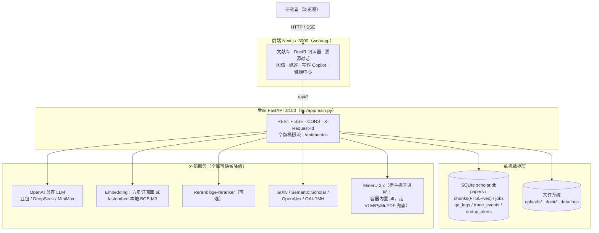
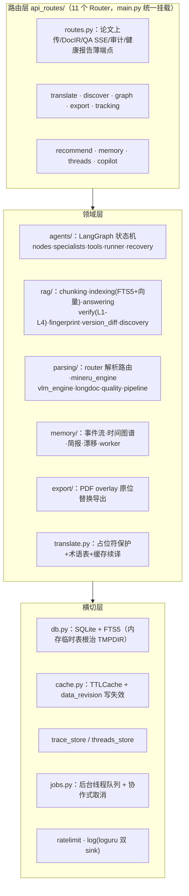
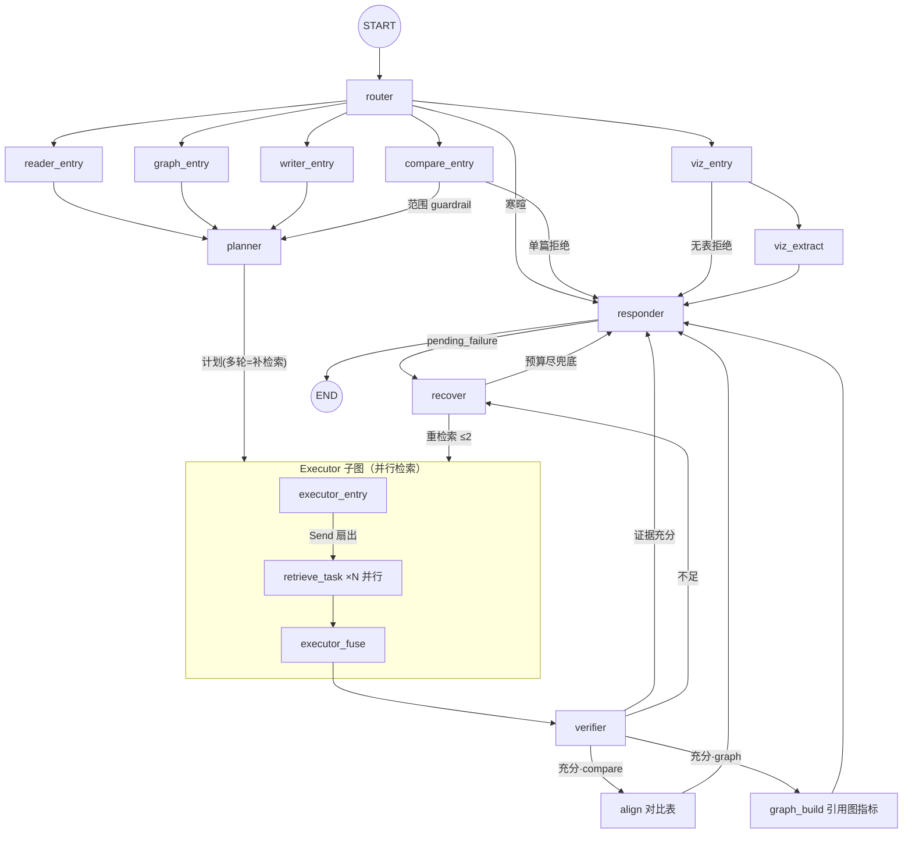
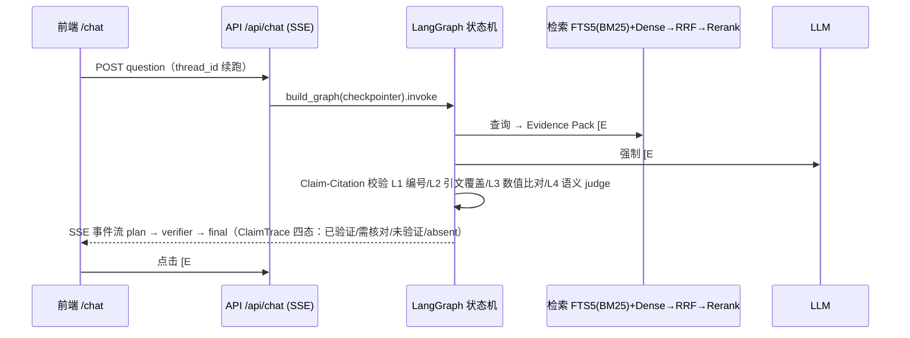
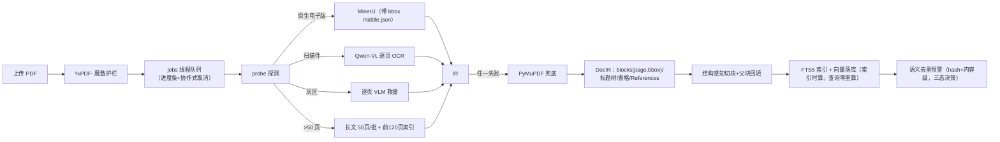
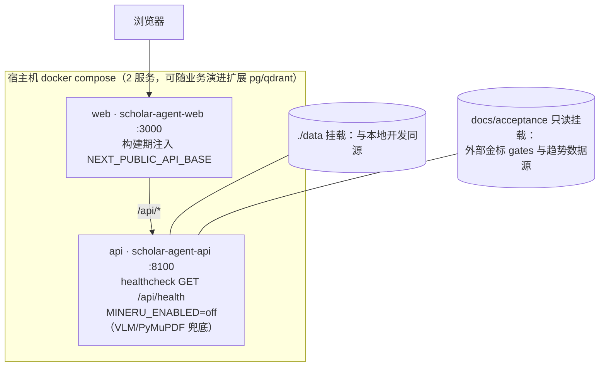

# Meridian 项目架构图

> 图为 Mermaid 源码，GitHub / VSCode Markdown 预览可直接渲染。
> 节点名与代码一一对应：后端 `api/app/`，前端 `web/app/`，Agent 状态机拓扑的权威定义在 `api/app/agents/graph.py`。

## 0. 一图速览（文字版）

```
浏览器 ──> Web(Next.js :3000) ──> API(FastAPI :8100) ──> LangGraph 五 Agent 状态机
                                        │                     │
                          SQLite(FTS5+向量) + 文件系统    检索(RRF)·LLM·四层校验
                                        │                     │
                              MinerU/VLM 解析管线          SSE 流式 + ClaimTrace
```

## 1. 系统上下文图



## 2. 后端分层架构



## 3. Agent 状态机（`agents/graph.py` 真实拓扑）



- LLM/易碎节点挂 RetryPolicy（瞬时基础设施错误自动重试）；业务级失败统一走 `recover`（全局 ≤3：重检索 ≤2、格式重生成 ≤2）；
- `SCHOLAR_FAIL_AT=节点:次数` 可注入故障，演示「崩溃 → 断点续跑」（SqliteSaver checkpoint）。

## 4. 溯源问答数据流（SSE）



## 5. 文档解析流水线（后台任务）



## 6. 前端页面结构（`web/app/`）

| 路由 | 页面 | 对应后端 |
|---|---|---|
| `/` | 文献库 + 数据带 + 最近问答卡 | `/api/papers` `/api/qa/recent` |
| `/chat` | 溯源对话（SSE + ClaimTrace 论断卡） | `/api/chat` |
| `/reader/{id}` | DocIR 阅读器（五视图 + 双向翻译） | `/api/docir` `/api/translate` |
| `/discover` | 多源检索 + 追踪 + 推荐 | `/api/discover` `/api/subscriptions` |
| `/ideas` | 综述 + Future Work 核查 | `/api/ideas` `/api/future-checks` |
| `/graph` | 引用图谱（G6 + 批量综述） | `/api/graph` |
| `/copilot` | 写作框架 / CSV 可视化 / 翻译 / 拓扑图 | `/api/copilot` |
| `/diff` | 版本差异 DiffLens | `/api/version-diff` |
| `/memory` | 记忆事件流 / 时间图谱 / 假设 FSM | `/api/memory` |
| `/audit` | Prompt 审计透明度中心 | `/api/audit` |
| `/health` | 结果健康评分卡（7 子分） | `/api/health-report` |
| `/judge` | 评审导览（8 步路线 + 工程证据） | 静态 + `lib/evidence.ts` |

## 7. 部署拓扑（docker-compose 单机栈）



- `make demo` 一键起栈（自动恢复 `data-real` 快照）；端口经 `.env` 的 `API_HOST_PORT` / `WEB_HOST_PORT` 覆盖；
- 云部署：web 镜像本地构建 → `save/load` 上服务器（`compose` 按名识别）。
